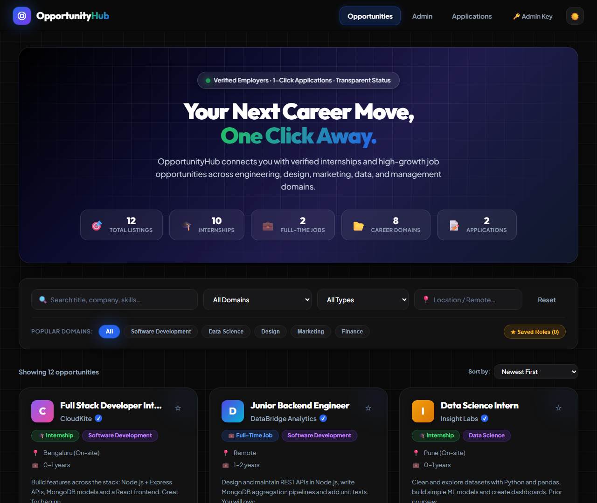
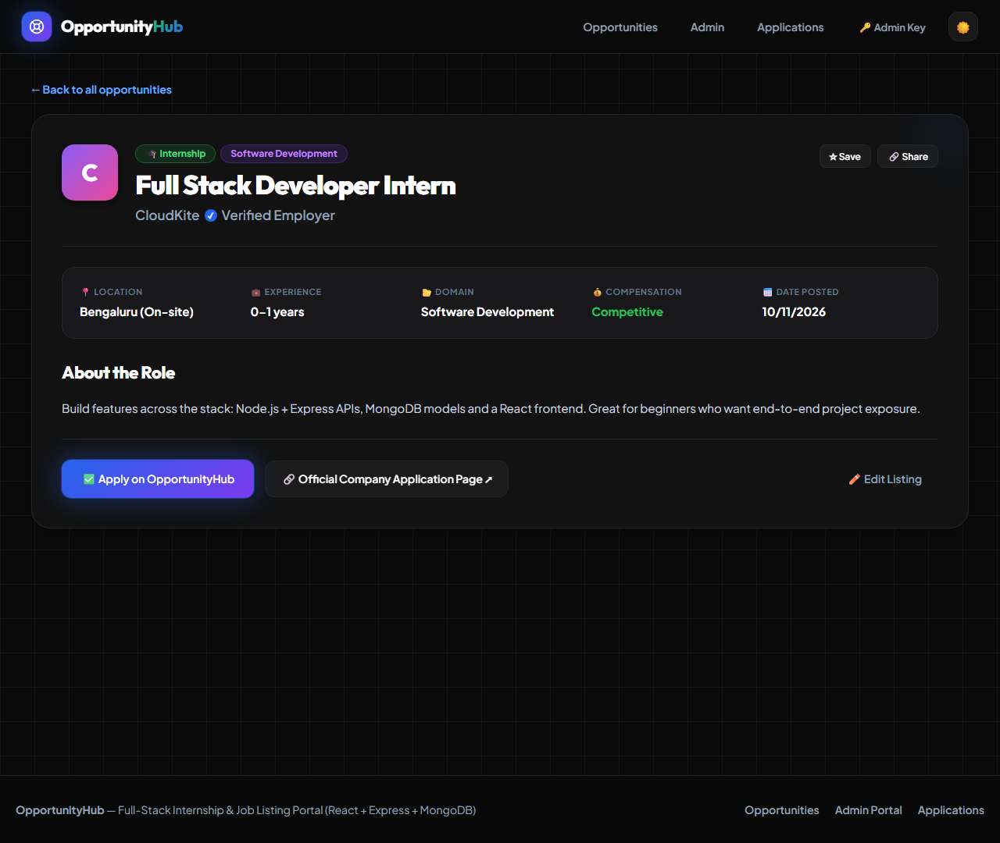
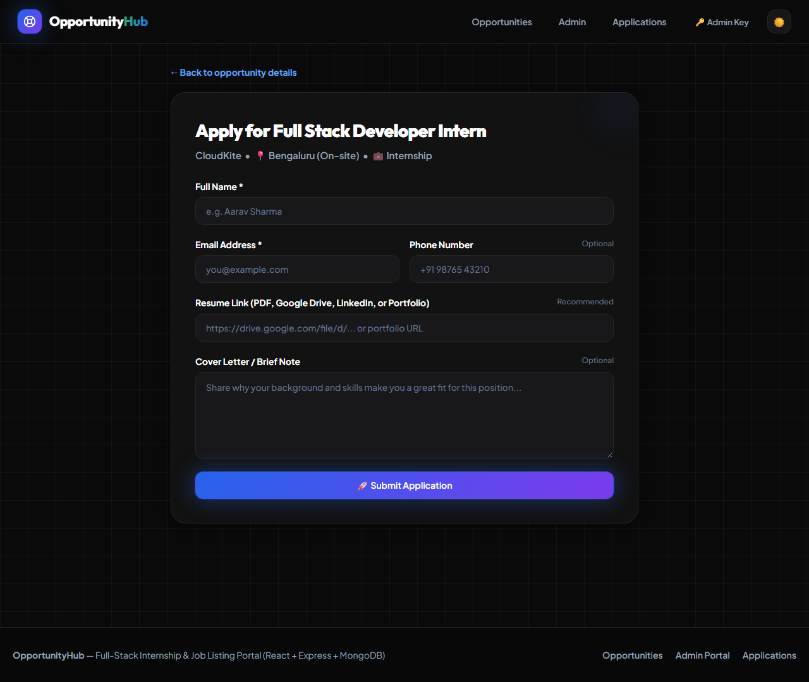
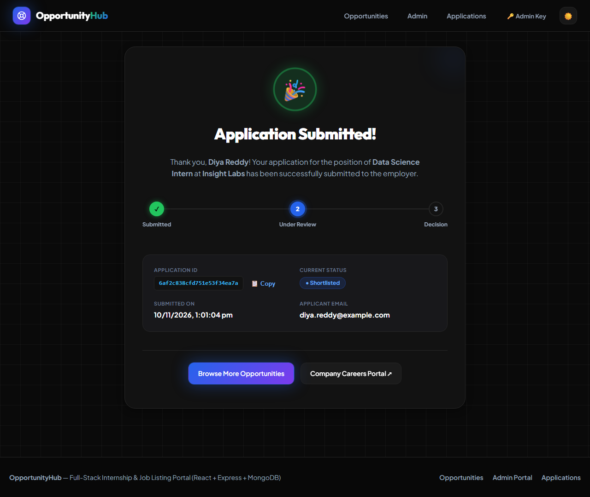
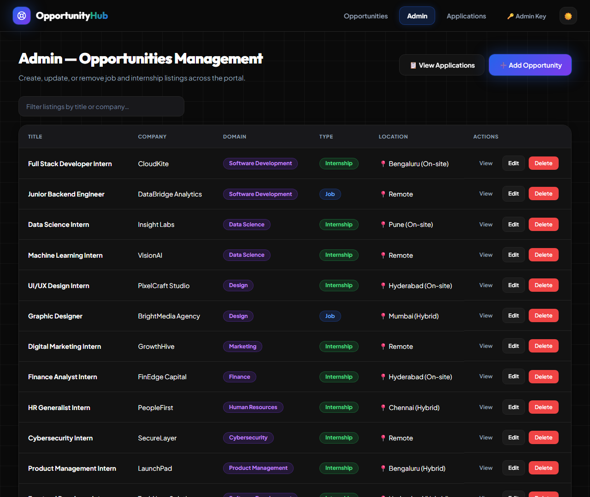
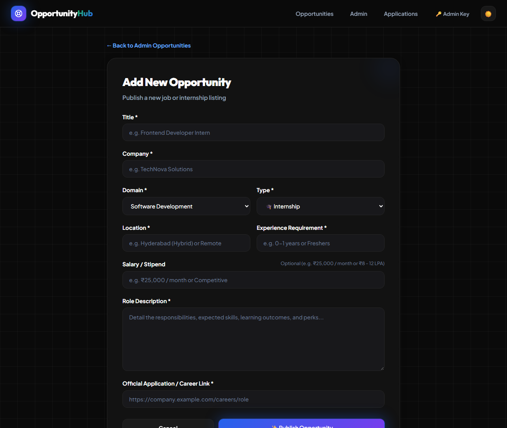
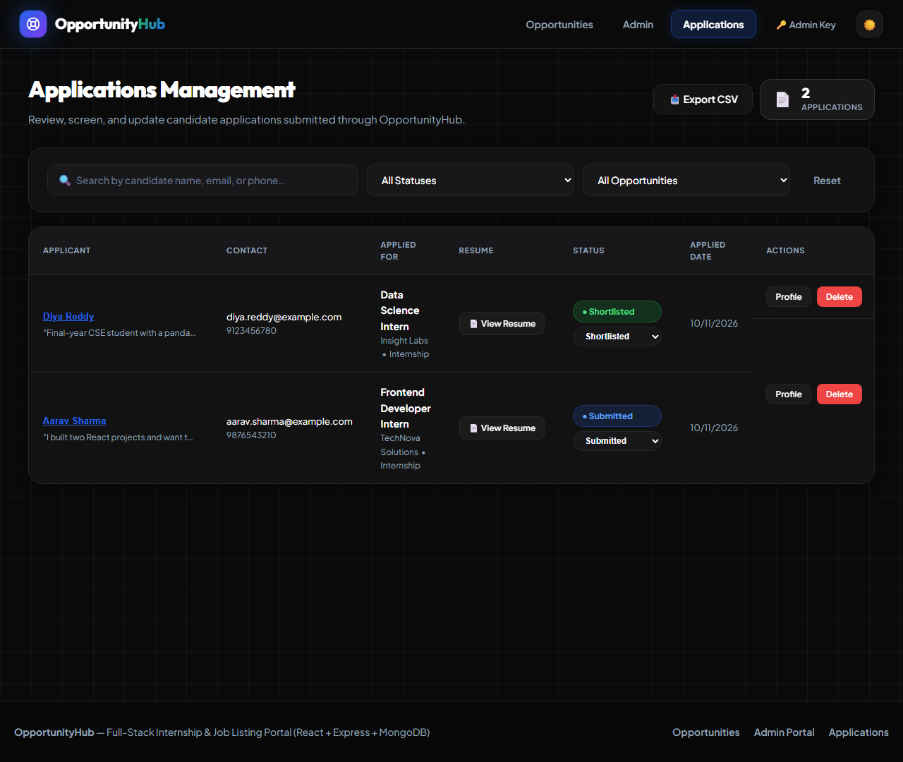

# Project Report — Internship & Job Listing Portal

**Level:** Beginner–Intermediate · **Duration:** 2 weeks · **Stack:** React.js (Vite) + Node.js/Express.js + MongoDB (Mongoose)

---

## 1. Objective
Build a complete, production-grade full-stack platform where users can view internship and job opportunities, search and filter them across domains, inspect in-depth role details, and submit applications ending with a confirmation page. Administrators can add, edit, and delete opportunities, and screen, filter, and dynamically update candidate application statuses.

---

## 2. Application Flow
1. **Visitor Landing**: Visitor lands on the portal home page → `GET /api/opportunities/stats` loads live summary counts into the hero ribbon, and `GET /api/opportunities` renders opportunity cards.
2. **Search & Filter**: Visitors search by keywords (debounced at 300ms) or filter by domain, type (Internship vs. Job), or location. Quick-filter tags allow 1-click domain switching.
3. **Role Details**: Clicking an opportunity card opens `/opportunity/:id` → `GET /api/opportunities/:id` renders employer verification badges, location, experience requirements, formatted description, and links.
4. **Application Submission**: Clicking "Apply on OpportunityHub" opens the application form at `/opportunity/:id/apply` → `POST /api/applications` validates applicant details, phone, resume link, and cover letter.
5. **Confirmation**: On success, the user is navigated to `/confirmation/:applicationId` → `GET /api/applications/:id` renders an animated celebration badge, application tracking timeline, and a 1-click "Copy Application ID" button.
6. **Admin Opportunities**: Opening `/admin` shows a table of all listings with live client-side search, direct "Add Opportunity" (`POST /api/opportunities`), "Edit" (`PUT /api/opportunities/:id`), and "Delete" with cascade deletion of related applications.
7. **Admin Applications**: Opening `/admin/applications` displays candidate submissions with search, status filtering (`Submitted`, `Under Review`, `Shortlisted`, `Rejected`), resume links, and an **interactive status changer** dropdown that updates statuses on the fly with instant feedback.
8. **Admin Key Management**: A header modal allows administrators to enter and persist an `ADMIN_KEY` (`x-admin-key` header) in localStorage for secure API interaction without altering code.

---

## 3. Database Design

### `opportunities` Collection
| Field | Type | Description |
|---|---|---|
| `_id` | `ObjectId` | Primary key |
| `title` | `String` | Required, trimmed, max 120 chars |
| `company` | `String` | Required, trimmed, max 120 chars |
| `domain` | `String` | Required, trimmed, indexed (e.g. Software Development) |
| `location` | `String` | Required, trimmed (e.g. Hyderabad, Remote) |
| `experience` | `String` | Required (e.g. 0-1 years, Freshers) |
| `description` | `String` | Required, max 5000 chars |
| `applicationLink` | `String` | Required URL to company portal |
| `type` | `String` | Enum: `['Internship', 'Job']`, default: `'Internship'` |
| `createdAt` / `updatedAt` | `Date` | Automated timestamps |

### `applications` Collection
| Field | Type | Description |
|---|---|---|
| `_id` | `ObjectId` | Primary key |
| `opportunity` | `ObjectId` | Ref to `Opportunity`, required |
| `name` | `String` | Required, trimmed |
| `email` | `String` | Required, validated regex |
| `phone` | `String` | Optional contact number |
| `resumeLink` | `String` | Optional link to Google Drive, Dropbox, LinkedIn |
| `coverLetter` | `String` | Optional candidate introduction |
| `status` | `String` | Enum: `['Submitted', 'Under Review', 'Shortlisted', 'Rejected']` |
| `createdAt` / `updatedAt` | `Date` | Automated timestamps |

---

## 4. API Design (REST)

Base URL: `http://localhost:5000/api` (or proxied via `http://localhost:5173/api`)

| Method | Endpoint | Description | Auth |
|---|---|---|---|
| `GET` | `/health` | Health check endpoint | Public |
| `GET` | `/opportunities` | List opportunities (`?search=&domain=&type=&location=`) | Public |
| `GET` | `/opportunities/domains` | Distinct list of career domains | Public |
| `GET` | `/opportunities/stats` | Platform summary counts | Public |
| `GET` | `/opportunities/:id` | Full details for one opportunity | Public |
| `POST` | `/opportunities` | Create opportunity | Admin |
| `PUT` | `/opportunities/:id` | Update opportunity | Admin |
| `DELETE` | `/opportunities/:id` | Delete opportunity & cascade delete its applications | Admin |
| `POST` | `/applications` | Submit application | Public |
| `GET` | `/applications/:id` | Get single application & populated opportunity | Public |
| `GET` | `/applications` | List applications (`?opportunityId=&status=&search=`) | Admin |
| `PATCH` | `/applications/:id/status` | Update candidate status | Admin |
| `DELETE` | `/applications/:id` | Remove application | Admin |

---

## 5. Dual Database Architecture & Zero-Config Mode
To guarantee 100% portability across all operating systems without requiring users to install MongoDB or dealing with external binary execution policies (such as Windows Application Control or AppLocker), the portal features an **intelligent dual-mode database layer**:
1. **Live MongoDB / Atlas Mode**: If `MONGO_URI` is provided and points to a running MongoDB instance or MongoDB Atlas cluster, Mongoose connects and operates normally.
2. **Embedded Pure-JS Store**: If external MongoDB is not reachable or `USE_IN_MEMORY_DB=true`, an embedded Mongoose-compatible pure-JavaScript store is activated automatically.
   - Requires zero external binaries or `.exe` spawning.
   - Enforces exact Mongoose schema validators, required fields, and enums.
   - Supports query chaining: `.find().sort().populate()`.
   - Persists state across restarts in `backend/data/db.json`.
   - Auto-seeds 12 realistic sample opportunities across 8 domains and 2 sample applications upon first launch.

---

## 6. Automated Testing Performed
An automated test suite is integrated using Node's native test runner (`npm --prefix backend test`):

| Test Suite | Result | Duration |
|---|---|---|
| `1. GET /api/health` | ✅ PASS | ~100ms |
| `2. GET /api/opportunities/stats` | ✅ PASS | ~10ms |
| `3. GET /api/opportunities` | ✅ PASS | ~7ms |
| `4. GET /api/opportunities?search=react` | ✅ PASS | ~8ms |
| `5. GET /api/opportunities/domains` | ✅ PASS | ~6ms |
| `6. Full CRUD on Opportunity & Application Lifecycle` | ✅ PASS | ~101ms |
| `7. Schema Validation Errors (Missing fields, bad email)` | ✅ PASS | ~21ms |
| **All Tests** | **7 / 7 PASSED** | **100% Green** |

---

## 7. Key Features & Enhancements Implemented
- 🌙 **CabGo Dark Mode Design System**: Transformed the entire frontend into a dark theme modeled after CabGo, with `#0A0A0A` obsidian background, `#121212` / `#18181b` card surfaces, `#262626` borders, Electric Blue (`#2563EB`) and Emerald (`#22C55E`) brand accents, ambient glow orbs on hover, and an integrated Sun/Moon theme switcher.
- 🎨 **Premium Glassmorphic UI/UX**: Frosted glass sticky navbar (`backdrop-filter: blur(16px)`), responsive card grid, deterministic company avatar gradients, and animated badges.
- ⚡ **Hero & Live Stats**: Real-time stats banner displaying total opportunities, internships, jobs, domains, and application counts.
- 🏷️ **Quick-Filter Domain Chips**: Instant 1-click domain switching for popular categories.
- 📋 **Interactive Admin Status Changer**: Administrators can update candidate statuses (`Submitted` → `Under Review` → `Shortlisted` / `Rejected`) directly within the table.
- 🔍 **Candidate Profile Modal**: Click any applicant name to open a slide-in dark modal with contact details, resume links, cover letter, and inline status changer.
- 📥 **CSV Export**: Export all filtered applications into formatted CSV with 1-click for spreadsheet analysis.
- ⭐ **Bookmarks / Saved Roles**: Save favourite opportunities to `localStorage` with a persistent star toggle and filter chip.
- 🔐 **Admin Key Header Modal**: Users can securely configure their admin key directly from the UI navbar.
- 📄 **Resume Link Support**: Full support for portfolio, Drive, and cloud resume links.
- 📋 **Copy to Clipboard**: One-click Application ID and Share Link copy with visual toast confirmation.
- 🛡️ **Cascade Deletion**: Deleting an opportunity automatically cleans up its associated applications to prevent orphaned records.

---

## 8. Captured Screenshots

All 7 application screens were rendered and captured:

### 1. Home Page — Search & Domain Filters

### 2. Opportunity Details Page

### 3. Application Form

### 4. Application Confirmation Screen

### 5. Admin — Opportunities Management

### 6. Admin — Add & Edit Opportunity Form

### 7. Admin — Applications Management Dashboard

---

## 9. Conclusion
The Internship & Job Listing Portal has been completed and verified end-to-end. All required core and bonus features have been implemented, thoroughly tested, and documented with clean, maintainable code.
